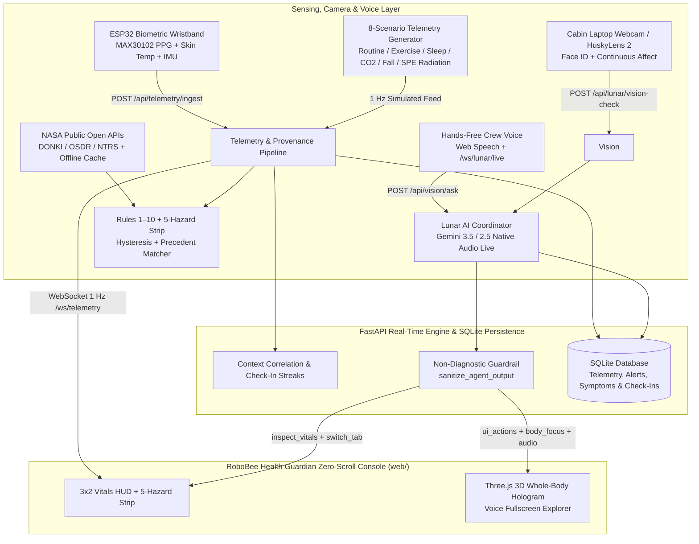

# ROBOBEE HEALTH GUARDIAN (AstroHealth Guardian v2.0)
### Astronaut Health Intelligence, 3D Anatomical Guidance & Hands-Free Lunar Voice Companion
*“Monitor the Crew. Understand the Signals. Protect the Mission.”*

[](https://opensource.org/licenses/Apache-2.0)
[](https://www.python.org/)
[](https://fastapi.tiangolo.com/)
[](https://threejs.org/)
[]()
[]()

---

> [!IMPORTANT]
> **Scientific Honesty & Non-Diagnostic Engineering Scope Disclaimer**
> RoboBee Health Guardian (AstroHealth Guardian) is an independent engineering prototype and technology demonstration platform developed by **Team RoboBee Innovators** (Lead: **Mostakim Rahman Mahir**) for the **2026 NASA Space Apps Challenge**. It is **not** developed, endorsed, flight-certified, or clinically validated by NASA. Displayed telemetry in demonstration mode represents synthetic modeling grounded in published aerospace standards (`NASA-STD-3001`, `NASA Spaceflight Standard Measures`), clearly separated from `LIVE` hardware sensor packets. Lunar provides operational monitoring and reference context only—never clinical diagnoses or medication prescriptions.

---

## 1. Executive Overview & Core Innovations

During deep-space and long-duration lunar/Mars exploration missions, astronauts operate far from terrestrial hospitals and live surgical teams. **RoboBee Health Guardian** unites wearable telemetry, habitat environmental monitoring, an interactive 3D anatomical human body explorer, cabin camera affect tracking, and hands-free spoken interaction with **Lunar**:

1. **Interactive 3D Anatomical Hologram & Voice Body-Only Full-Screen Guidance (`web/body-model.js`)**:
   - Real-time Three.js WebGL whole-body anatomical hologram targeting 28 body regions (`head`, `neck`, `left-shoulder`, `right-shoulder`, `left-shoulder-joint`, `right-shoulder-joint`, `left-finger`, `right-finger`, `chest`, `abdomen`, `left-knee`, `right-knee`, etc.) with autonomous voice-driven full-screen body takeover that exits back to the home console by default.
   - **Voice-Driven 3D Zoom & Pain Trademark**: When an astronaut reports a concern (e.g., *"I have a big pain on my shoulder"*), Lunar zooms into that exact anatomical region, places a persistent 3D highlight and **Pain Trademark** badge on the model, logs the report to SQLite, and conducts a conversational check-in.
   - **Evidence-Gated Highlight Fading**: Symptom highlights never fade on an automatic timer; intensity only decreases or clears when the astronaut confirms improvement or resolution via follow-up (`POST /api/symptoms/{id}/followup`).
2. **NASA 5-Hazards Monitor & Historical Spaceflight Incident Matcher (`src/data/incidents.py`)**:
   - Real-time status strip evaluating all five NASA Human Research Program hazards (**Radiation**, **Isolation & Confinement**, **Distance from Earth**, **Gravity Fields**, **Hostile/Closed Environments**).
   - **Historical Incident Comparison Engine**: Compares live crew vitals, symptoms, and queries against 7 grounded historical precedents (`Apollo 13 CO2`, `Skylab 2 Arrhythmia`, `ISS SANS / IJV Thrombosis`, `Skylab 4 Musculoskeletal Strain`, `EVA-23 Parmitano Hypoxia/Water`, `Apollo SPE Radiation`, `Mir Environmental/Metabolic`) with step-by-step verification checks and countermeasure cues (`GET /api/incidents`, `GET /api/incidents/match`).
3. **Live Public NASA APIs + Offline Mars Delay Autonomy (`src/data/nasa_open_apis.py`)**:
   - Queries live `api.nasa.gov/DONKI` (solar flare / geomagnetic space weather), `osdr.nasa.gov` (Open Science Data Repository), and `ntrs.nasa.gov` (NASA Technical Reports Server) with disk/memory caching (`data/nasa_api_cache.json`) and an explicit **Mars Delay (1200s) / Autonomous Offline Mode** toggle (`POST /api/nasa/offline-mode`).
4. **Default Cabin Camera Face ID, Single-Voice Lunar Live Audio & Gamified Crew Check-In**:
   - Activates the cabin webcam on startup (`#dashboard-webcam`) to identify `CREW-01`, monitors facial expressions via `POST /api/lunar/vision-check`, and runs multi-turn bidirectional voice streaming via `/ws/lunar/live` (`gemini-2.5-flash-native-audio-latest`) locked to a single natural female voice (`Aoede`) plus Hands-Free Web Speech fallback.
   - **Challenge-Complete Biometrics & Habit Compliance**: Tracks heart rate, SpO2, cuffless BP, core temperature, blood glucose (`mg/dL`), hydration (`mL` / `%`), daily mood (`1–5`), and SANS/IJV ultrasound checks via SQLite (`POST /api/crew/checkin`, `GET /api/crew/compliance`) with streaks, XP, and earned crew badges.
5. **Honest Telemetry Provenance (`LIVE` vs. `SIMULATED` vs. `DERIVED`)**:
   - Every measurement carries explicit provenance (`live_hardware`, `simulated`, `derived`, `stale`, `unavailable`).
   - In `LIVE` hardware mode (`POST /api/telemetry/ingest`), unmeasured channels are marked `MISSING`/`unavailable` and never silently filled with synthetic fallback numbers.

---

## 2. System Architecture



---

## 3. Key API Endpoints

| Method & Route | Description |
| :--- | :--- |
| `GET /api/health` | System health check, active scenario, source mode, and SQLite status. |
| `GET /api/telemetry/latest` | Latest telemetry frame with per-metric provenance (`live`, `simulated`, `derived`, `unavailable`). |
| `POST /api/telemetry/ingest` | Live hardware Schema v1.0 ingestion (strictly preserves `MISSING` channels without synthetic fill). |
| `GET /api/incidents` & `GET /api/incidents/match` | Evaluates the 5 NASA Hazards on current vitals and ranks matching historical incidents (`Apollo 13`, `Skylab 2/4`, `ISS SANS`, `EVA-23`, `Mir`). |
| `GET /api/nasa/live-context` & `POST /api/nasa/offline-mode` | Fetches cached/live NASA `DONKI`, `OSDR`, and `NTRS` data and toggles Mars 20-min communication delay / autonomous offline mode. |
| `POST /api/crew/checkin` & `GET /api/crew/compliance` | Logs hydration, mood score, blood glucose, and SANS/IJV ultrasound checks with SQLite streak, XP, and badge computation. |
| `POST /api/lunar/vision-check` | Laptop webcam astronaut Face ID, continuous facial expression analysis, and initial spoken greeting. |
| `POST /api/vision/ask` (`/api/lunar/ask`) | Lunar conversational coordinator returning `answer`, `body_focus`, `ui_actions`, `symptom_report`, and Gemini TTS `audio_base64`. |
| `POST /api/lunar/speak` | Synthesizes natural spoken WAV audio (`audio/wav` base64) via Gemini TTS. |
| `WS /ws/lunar/live` | Bidirectional multi-turn real-time voice WebSocket connected to `gemini-2.5-flash-native-audio-latest` with live 3D `body_focus`, incident comparison, and check-in tool calls. |
| `POST /api/symptoms` & `GET /api/symptoms` | Creates and lists persistent SQLite symptom reports tied to validated 3D body regions. |
| `POST /api/symptoms/{id}/followup` | Crew-confirmed symptom follow-up that updates or resolves 3D highlight intensity. |
| `GET /api/symptoms/reminders` | Lists due in-console symptom follow-up check-ins (`delivery_mechanism: "in_console_pull"`). |

---

## 4. Quick Start & Execution Guide

### Prerequisites
* **Python 3.10+** (tested on Python 3.13)
* **Google Chrome** or **Microsoft Edge** (for WebGL 3D rendering, webcam access, and Web Speech recognition)

### 1. Install Dependencies
```bash
python -m pip install -r requirements.txt
```

### 2. Configure Environment (`.env`)
Copy `.env.example` to `.env` and add your Google Gemini API key (if omitted, Lunar automatically falls back to its deterministic non-diagnostic engine and browser speech synthesis):
```bash
cp .env.example .env
```

### 3. Run the Application Server
```bash
python -m uvicorn src.api.stream:app --host 127.0.0.1 --port 8000
```
Open **[http://127.0.0.1:8000](http://127.0.0.1:8000)** in your browser.
- Allow camera and microphone access when prompted so Lunar can recognize your face (`Crew One`), greet you by voice, monitor facial expressions, and respond hands-free to commands such as:
  - *"I have some pain on the shoulder"*
  - *"Just let me check the pressure, let me check the oxygen level"*

### 4. Run Automated Tests
```bash
python -m pytest tests -v
```
All **35 automated tests** (`tests/test_alert_rules.py`, `tests/test_api_endpoints.py`, `tests/test_generator.py`, `tests/test_storage.py`, `tests/test_telemetry_schema.py`, `tests/test_websocket.py`) pass.

---

## 5. NASA References, Crosswalk & AI Transparency
* **NASA / CSA Hazard & Resource Crosswalk**: See [`SPACE_APPS_RESOURCE_CROSSWALK.md`](SPACE_APPS_RESOURCE_CROSSWALK.md)
* **Prompt-by-Prompt AI Use & Human Creativity Disclosure**: See [`docs/AI_USE.md`](docs/AI_USE.md)
* **3D Model & Library Notices**: See [`web/models/THIRD_PARTY_NOTICES.md`](web/models/THIRD_PARTY_NOTICES.md)

---

## 6. License
Apache License 2.0. See [LICENSE](LICENSE) for details.
