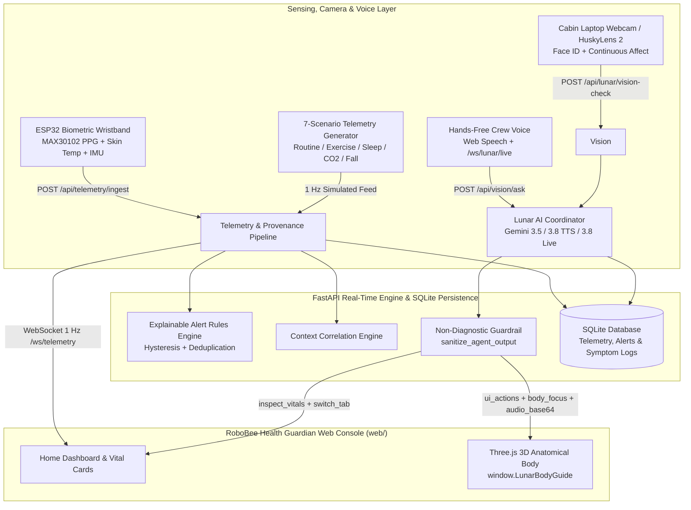

# ROBOBEE HEALTH GUARDIAN (AstroHealth Guardian v2.0)
### Astronaut Health Intelligence, 3D Anatomical Guidance & Hands-Free Lunar Voice Companion
*“Monitor the Crew. Understand the Signals. Protect the Mission.”*

[](https://opensource.org/licenses/Apache-2.0)
[](https://www.python.org/)
[](https://fastapi.tiangolo.com/)
[](https://threejs.org/)
[]()
[]()

---

> [!IMPORTANT]
> **Scientific Honesty & Non-Diagnostic Engineering Scope Disclaimer**
> RoboBee Health Guardian (AstroHealth Guardian) is an independent engineering prototype and technology demonstration platform developed by **Team RoboBee Innovators** (Lead: **Mostakim Rahman Mahir**) for the **2026 NASA Space Apps Challenge**. It is **not** developed, endorsed, flight-certified, or clinically validated by NASA. Displayed telemetry in demonstration mode represents synthetic modeling grounded in published aerospace standards (`NASA-STD-3001`, `NASA Spaceflight Standard Measures`), clearly separated from `LIVE` hardware sensor packets. Lunar provides operational monitoring and reference context only—never clinical diagnoses or medication prescriptions.

---

## 1. Executive Overview & Core Innovations

During deep-space and long-duration lunar/Mars exploration missions, astronauts operate far from terrestrial hospitals and live surgical teams. **RoboBee Health Guardian** unites wearable telemetry, habitat environmental monitoring, an interactive 3D anatomical human body explorer, cabin camera affect tracking, and hands-free spoken interaction with **Lunar**:

1. **Interactive 3D Anatomical Hologram & Symptom Guidance (`web/body-model.js`)**:
   - Real-time Three.js WebGL anatomical body with selectable layers (`Full body`, `Heart`, `Lungs`, `Skeleton`) and 28 targetable body regions (`head`, `neck`, `left-shoulder`, `right-shoulder`, `left-shoulder-joint`, `right-shoulder-joint`, `left-finger`, `right-finger`, `chest`, `abdomen`, `left-knee`, `right-knee`, etc.).
   - **Voice-Driven 3D Zoom & Pain Trademark**: When an astronaut reports a concern (e.g., *"I have some pain on the shoulder"*), Lunar autonomously zooms the 3D camera into that exact anatomical region, switches to `Skeleton` view for bone/joint concerns, places a persistent 3D highlight and **Pain Trademark** badge on the model, logs the report to SQLite, and asks targeted follow-up questions (*which exact part hurts, whether physical hurt/strain occurred, and how many days the pain has lasted*).
   - **Evidence-Gated Highlight Fading**: Symptom highlights never fade on an automatic timer; intensity only decreases or clears when the astronaut confirms improvement or resolution via follow-up (`POST /api/symptoms/{id}/followup`).
2. **Default Cabin Camera Face Recognition & Continuous Affect Monitoring**:
   - Automatically activates the cabin/laptop camera on dashboard startup (`#dashboard-webcam`), locks onto the astronaut's identity (`CREW-01: Crew One / Cmdr. Mostakim Rahman Mahir`), and speaks a personalized greeting out loud (*"Hey Crew One, how are you doing today?"*).
   - Continuously monitors facial expression (`Happy`, `Calm / Nominal`, `Focused`, `Fatigued / Drowsy`, `Tense / Stressed`, `Sad / Depressed`, `Pain / Discomfort`) via `POST /api/lunar/vision-check` and correlates affect with physiological vitals.
3. **Hands-Free Voice-Only Autonomous Website Operation (Gemini Interactions, 3.8 TTS & 3.8 Live)**:
   - Continuous hands-free speech recognition (`SpeechRecognition` with automatic echo-safe pause/resume during TTS playback) plus real-time bidirectional PCM audio streaming over `WebSocket /ws/lunar/live` (`gemini-3.8-live`).
   - **Autonomous Vital Checks**: Asking *"Just let me check the pressure, let me check the oxygen level"* causes Lunar to sequentially highlight and scan the Blood Pressure (`#card-bp`), Blood Oxygen (`#card-spo2`), and Heart Rate (`#card-hr`) HUD cards while speaking a clear evaluation against nominal flight targets.
4. **Honest Telemetry Provenance (`LIVE` vs. `SIMULATED` vs. `DERIVED`)**:
   - Every measurement carries explicit provenance (`live_hardware`, `simulated`, `derived`, `stale`, `unavailable`).
   - In `LIVE` hardware mode (`POST /api/telemetry/ingest`), unmeasured channels are marked `MISSING`/`unavailable` and never silently filled with synthetic fallback numbers.

---

## 2. System Architecture



---

## 3. Key API Endpoints

| Method & Route | Description |
| :--- | :--- |
| `GET /api/health` | System health check, active scenario, source mode, and SQLite status. |
| `GET /api/telemetry/latest` | Latest telemetry frame with per-metric provenance (`live`, `simulated`, `derived`, `unavailable`). |
| `POST /api/telemetry/ingest` | Live hardware Schema v1.0 ingestion (strictly preserves `MISSING` channels without synthetic fill). |
| `POST /api/lunar/vision-check` | Laptop webcam astronaut Face ID, continuous facial expression analysis, and initial spoken greeting. |
| `POST /api/vision/ask` (`/api/lunar/ask`) | Lunar conversational coordinator returning `answer`, `body_focus`, `ui_actions`, `symptom_report`, and Gemini TTS `audio_base64`. |
| `POST /api/lunar/speak` | Synthesizes natural spoken WAV audio (`audio/wav` base64) via Gemini 3.8 TTS. |
| `WS /ws/lunar/live` | Bidirectional real-time voice WebSocket connected to `gemini-3.8-live` with live 3D `body_focus` triggers. |
| `POST /api/symptoms` & `GET /api/symptoms` | Creates and lists persistent SQLite symptom reports tied to validated 3D body regions. |
| `POST /api/symptoms/{id}/followup` | Crew-confirmed symptom follow-up that updates or resolves 3D highlight intensity. |
| `GET /api/symptoms/reminders` | Lists due in-console symptom follow-up check-ins (`delivery_mechanism: "in_console_pull"`). |

---

## 4. Quick Start & Execution Guide

### Prerequisites
* **Python 3.10+** (tested on Python 3.13)
* **Google Chrome** or **Microsoft Edge** (for WebGL 3D rendering, webcam access, and Web Speech recognition)

### 1. Install Dependencies
```bash
python -m pip install -r requirements.txt
```

### 2. Configure Environment (`.env`)
Copy `.env.example` to `.env` and add your Google Gemini API key (if omitted, Lunar automatically falls back to its deterministic non-diagnostic engine and browser speech synthesis):
```bash
cp .env.example .env
```

### 3. Run the Application Server
```bash
python -m uvicorn src.api.stream:app --host 127.0.0.1 --port 8000
```
Open **[http://127.0.0.1:8000](http://127.0.0.1:8000)** in your browser.
- Allow camera and microphone access when prompted so Lunar can recognize your face (`Crew One`), greet you by voice, monitor facial expressions, and respond hands-free to commands such as:
  - *"I have some pain on the shoulder"*
  - *"Just let me check the pressure, let me check the oxygen level"*

### 4. Run Automated Tests
```bash
python -m pytest tests -v
```
All **33 automated tests** (`tests/test_alert_rules.py`, `tests/test_api_endpoints.py`, `tests/test_generator.py`, `tests/test_storage.py`, `tests/test_telemetry_schema.py`, `tests/test_websocket.py`) pass.

---

## 5. NASA References, Crosswalk & AI Transparency
* **NASA / CSA Hazard & Resource Crosswalk**: See [`SPACE_APPS_RESOURCE_CROSSWALK.md`](SPACE_APPS_RESOURCE_CROSSWALK.md)
* **Prompt-by-Prompt AI Use & Human Creativity Disclosure**: See [`docs/AI_USE.md`](docs/AI_USE.md)
* **3D Model & Library Notices**: See [`web/models/THIRD_PARTY_NOTICES.md`](web/models/THIRD_PARTY_NOTICES.md)

---

## 6. License
Apache License 2.0. See [LICENSE](LICENSE) for details.
